<picture>
  <source media="(prefers-color-scheme: dark)" srcset="assets/header-dark.svg">
  <source media="(prefers-color-scheme: light)" srcset="assets/header-light.svg">
  
</picture>

<samp>
  <a href="https://ahmedakram.dev">ahmedakram.dev</a> ·
  <a href="https://www.linkedin.com/in/ahmedakram1">linkedin</a> ·
  <a href="mailto:me@ahmedakram.dev">me@ahmedakram.dev</a>
</samp>

<!-- stats:start -->
 

<picture>
  <source media="(prefers-color-scheme: dark)" srcset="assets/stats-dark.svg">
  <source media="(prefers-color-scheme: light)" srcset="assets/stats-light.svg">
  
</picture>
<!-- stats:end -->
